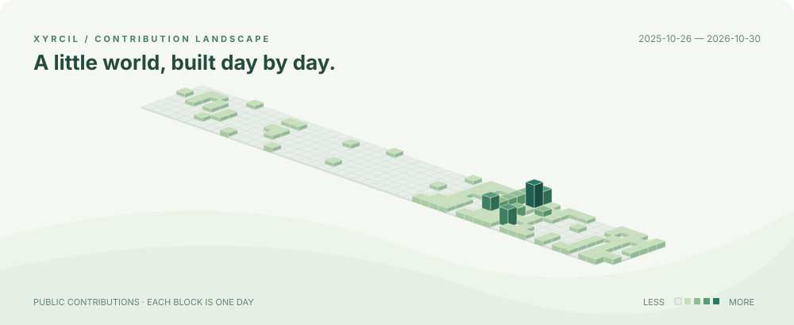

# Hi, I'm Xyrcil 👋

Making small tools and exploring creative worlds, one block at a time.

### Selected projects

| Project | What it does |
| :-- | :-- |
| [MTE Spine Studio](https://github.com/Xyrcil/mte-spine-studio) | An unofficial artwork viewer and scene editor for learning and reference. |
| [GIF ↔ Sprite Sheet](https://github.com/Xyrcil/gif-spritesheet-interconversion) | A web tool for converting between GIFs and sprite sheets. |
| [MTE Learning Tools](https://github.com/Xyrcil/mte-learning-tools) | Small Python tools for Android package assembly and local protocol testing. |

Built with curiosity · Explore the <a href="https://github.com/Xyrcil?tab=repositories">repositories</a>

